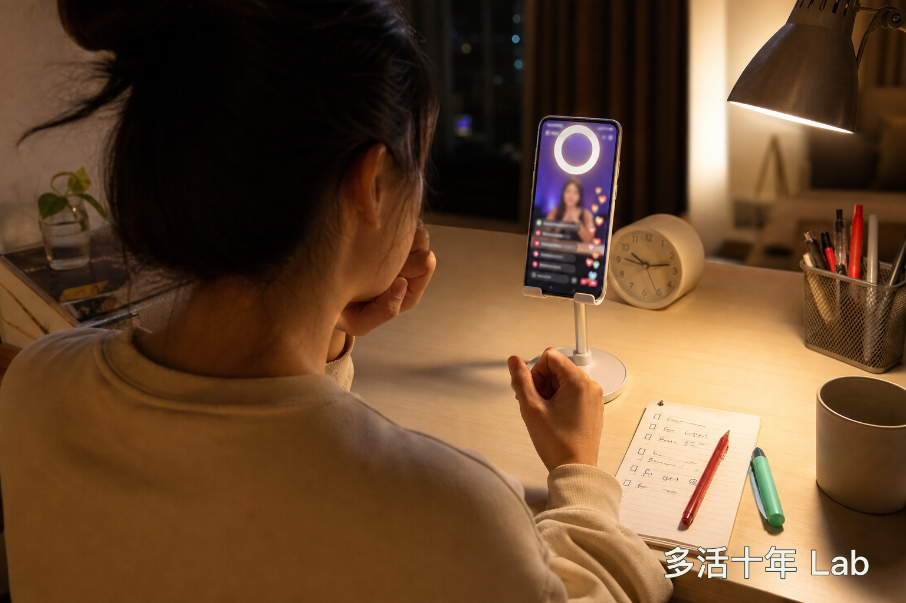
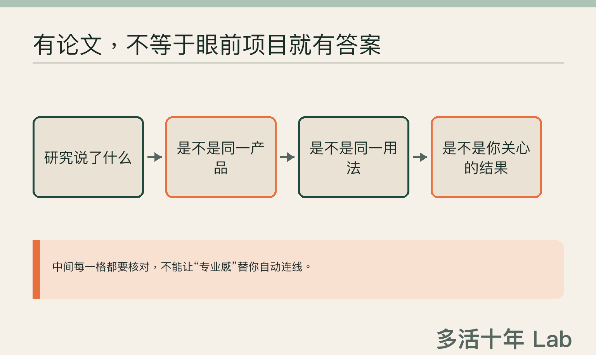
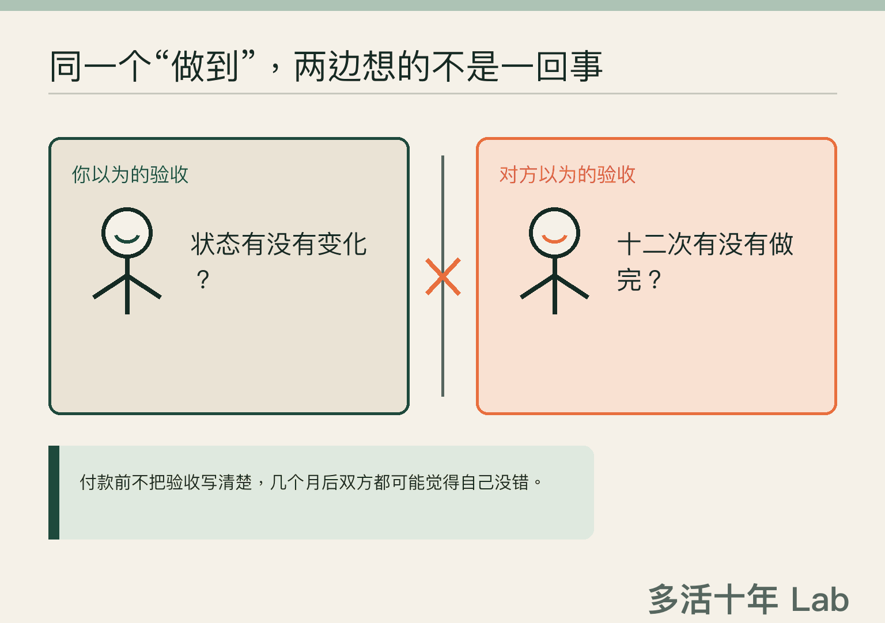

晚上十点多，你本来只想刷两分钟手机。

嗯，真的只是两分钟。

结果直播间里灯光一亮，主播语速快得像在跟倒计时赛跑，旁边的嘉宾稳稳点头，评论区一片“已下单”。

“今天最后一场。”

“现在拍最划算。”

“很多人做完以后，整个状态都不一样了。”

好家伙。

一套组合拳下来，你会觉得现在不付钱，错过的可能不只是一张优惠券，还有未来十年的健康。

听着听着，甚至有种错觉：这几万元花下去，买到的不只是一套检测、几次服务或者一台设备，连十年前那个精力更好、身体更轻松的自己，都能顺便打包寄回来。

然后，页面跳到付款那一步。

手指悬在按钮上，很多人的第一反应是：“还能不能再便宜点？”

> ✋ **先别急着问还能不能便宜。先问：这几万元，我到底买到了什么？**

## “智商税”三个字，说起来爽，基本没啥用

我不赞成一看到高价健康项目，就站在旁边凉凉地来一句：“智商税。”

这话说起来很爽，问题是，它几乎没有帮你做任何判断。

有些服务需要设备、场地和专业人员。**贵，不等于没价值；便宜，也不等于值得。**毕竟“花得少”和“花得明白”，完全是两回事。

真正麻烦的是，钱还没付的时候，每句话都闪着金光；钱付完以后，双方连承诺的是不是同一件事都说不清。

所以，别急着给它贴“值”或“不值”的标签。先把宣传页上的漂亮话，翻译成**四个能落到纸上的问题**。

别误会，这不是让你付款前突然转行成法务、研究员兼项目经理。买一个健康项目，没必要顺便给自己安排三份兼职。

## 第一问：我具体买到了什么？

比如“改善状态”。

多好听啊。问题是，它到底什么意思？

是完成一次检测，给你一份报告？

是有人陪你执行一段时间？

还是最后真的要出现某种健康结果？

如果这些都能塞进“改善状态”四个字，那这四个字的业务范围也太广了点。

这就不太像服务说明了，多少有点像许愿池：你负责投币，愿望负责自由发挥。

卖的是检测，就说清最后交付什么、由谁解释、哪些问题它回答不了；卖的是长期服务，就说清一共几次、谁来做、中途换人怎么办；暗示某种健康结果，就更该讲明白这个说法从哪儿来、适用于谁、有什么限制。

现行消费者权益规则里有个很朴素的原则：经营者提供的信息应当真实、全面，对消费者提出的问题作出真实、明确的答复。

普通人不必站在付款台前背法条。你只需要把一句话问到底：**这笔钱买到的，究竟是一次交付、一段服务，还是一个可以验收的结果？**

如果连卖给你的是什么都要靠你自己悟，这几万元多少有点像阅读理解报名费。

## 第二问：论文封面闪得挺快，结论呢？

健康项目通常不缺“证据感”。

墙上挂着证书，页面里有专家名字，论文封面一闪而过，再配几个用户故事。

专业感到了。

结论还在路上。

论文不是护身符，往页面上一贴，眼前的项目不会自动获得“科学认证”。

> 🔍 **有论文，只能说明“有论文”。从研究结论到眼前项目，中间每一步都要核对。**

真正该问的不是“你们有没有论文”，而是：“这篇论文证明了什么，跟我准备买的东西有什么关系？”

研究里的产品是眼前这一个吗？使用方法一样吗？研究对象和我是一类人吗？它只是让某个数字发生变化，还是能说明人真正关心的结果会改善？

专家名字可以放得很大，适用范围和限制也别缩成蚂蚁字。科学不是看谁的页面更像颁奖典礼。

普通人不用在直播间里临时转行当研究员。

**谁提出承诺，谁就应该把依据、适用范围和不知道的地方说清楚。**涉及检查、治疗、康复或者医疗器械的专业用途，也别只听销售自己完成自问自答，最好再找独立、具备相应资质的专业人员确认。

案例和口碑可以帮助了解服务体验，但不能单独证明医学效果；一篇论文，也不能自动证明眼前这套东西适合每个人。

## 第三问：什么情况才算“做到”？

真正的高能场面，通常发生在几个月以后。

你说：“好像没什么感觉。”

对方把服务记录往前一推：“十二次，一次没少，我们全部做完了。”

你觉得钱白花了，他觉得任务早交付了。

嗯，这就尴尬了。

一个验收身体感受，一个验收签到次数。鸡同鸭讲，还认真开了发票。

两边甚至都没撒谎，只是付款之前，谁也没认真说清楚怎样才算“做到”。

> 🧾 **服务做完，不等于健康结果改善。先把验收写清楚。**

所以有些话不能留到结束以后再谈：从哪里开始记录？看什么结果？多久以后复盘？谁来测量，谁来解释？中途换人、延期或者无法继续，又怎么办？

身体后来变好了，也不能只看时间顺序，就把功劳全部颁给最后买的那个项目。

把十二个勾打齐，最多证明日历很努力；它还没有自动升级成健康结果。

越是健康相关的消费，越该趁热情还没冲上头，把验收方式冷静地写下来。

**热情很贵。**

白纸黑字，通常便宜得多。

## 第四问：没做到，找谁？

有些项目宣传的是一个品牌，签合同的是另一家公司，钱进了第三个账户，真正服务的又是合作方。

平时一切顺利，这些名字看着像工商知识加餐。真遇到退费、换人、停业或者服务争议，它们立刻变成主线剧情。

责任主体不是俄罗斯套娃，不能等出事以后才一层层拆。

**谁收钱，谁提供服务，发票由谁开，出问题找谁。**退款和暂停怎么办——付款前问清，能省下以后在几百页聊天记录里考古的时间。

预付型服务尤其要看书面合同。服务内容、费用、退款方式和违约责任，不能只靠一句“放心，我们一直都可以退”。不同交易适用的具体规则并不完全相同，真发生争议，还得结合合同和事实判断。

“放心”两个字气氛很好，可惜通常不属于合同条款。

如果项目还要收体检报告、病历、影像或者其他健康资料，也别看见“我已阅读并同意”就一路划到底。

为什么要这些资料？保存多久？会不会交给其他机构？以后怎样查询、更正或删除？

**医疗健康信息属于敏感个人信息。**这不是注册一个买菜 App，多收一项少收一项都无所谓。

健康资料也不是为了让表格显得充实，就顺手多收两项。

## 付款前，把这四句话发过去

> ✅ **付款前，把交付、证据、验收和责任写到纸上。**

> **我具体买到什么？包含什么，不包含什么？**  
> **哪些依据支持哪些承诺？适用于谁，有什么限制？**  
> **付款前怎样确定目标、记录方式和复盘时间？**  
> **谁收钱、谁服务、谁负责？退出和数据处理怎么办？**

四句话都回答得很好，也不代表一定该买；其中一句答不上来，也不能当场给对方定罪。

但如果所有承诺都只肯在嘴上飞，不肯在纸上落地——行吧，至少先把付款页面关掉。

**今晚不买，通常不会立刻失去未来十年的健康。**

## 这张功课单不能替你决定什么

至于一项具体检查、治疗、康复或者设备是否有效、是否适合自己，仍然需要独立的专业判断。

这张卡只能帮你核对信息，不能替你作医疗决定，也不是个案法律意见。

有些钱不是不能花。

怕的是花完以后，连自己买了什么都说不清。

你遇到过最难判断值不值的健康消费是什么？当时哪句话，让你差点就按下了付款？

### 附录｜来源与说明

**资料参考：**本文涉及的消费者权益、预付消费和个人信息规则，主要参考《中华人民共和国消费者权益保护法》《中华人民共和国消费者权益保护法实施条例》《中华人民共和国个人信息保护法》及最高人民法院预付式消费司法解释；医疗科普与广告边界参考 2025 年有关“自媒体”医疗科普通知和《医疗广告认定指南》。

**必要说明：**文中的“承诺—证据—验收—责任”四问，是健年基于上述公开规则所作的便民归纳，并非监管部门发布的官方清单，不构成医疗或法律意见。开场与对话为典型消费场景的文学化组合，不对应真实机构、人物或采访。
