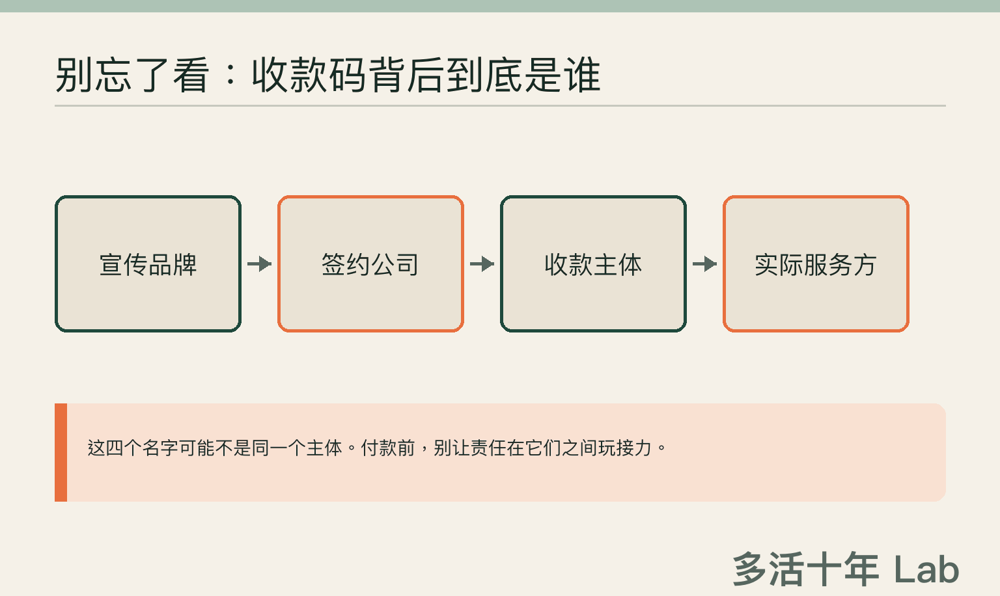
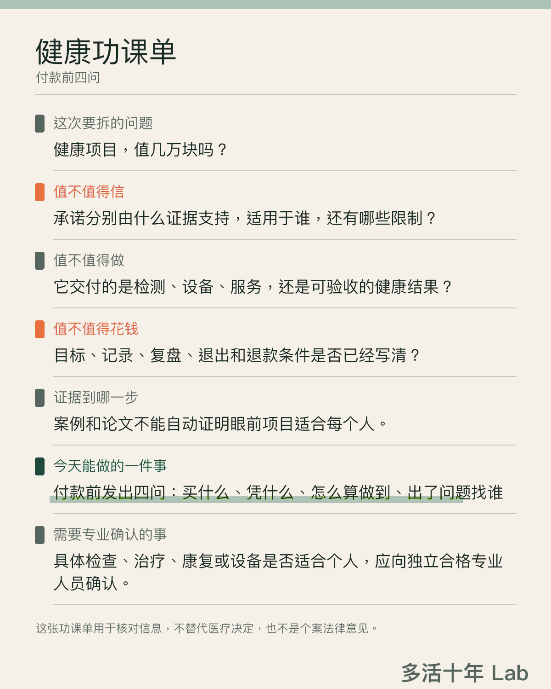

晚上十点多，你本来只想刷两分钟手机。

嗯，真的只是两分钟。

直播间的灯一亮，主播语速快得像身后有人掐表，旁边的嘉宾稳稳点头，评论区一排“已下单”往上飘。

“今天最后一场。”

“现在拍最划算。”

“很多人做完，整个状态都不一样了。”

这套节奏很熟练。优惠在倒计时，名额在减少，未来十年的健康仿佛也排进了库存，晚一步就要发完。

好家伙。

几轮话术下来，你甚至会觉得这几万元买到的不只是一套检测、几次服务或者一台设备。十年前那个精力更好、身体更轻松的自己，好像也能顺手打包寄回来。

然后，页面跳到付款那一步。

手指悬在按钮上，很多人的第一个问题是“还能不能再便宜点”。

> ✋ **先别忙着砍价。问清这几万元到底买到了什么，往往更省钱。**

## 先别骂“智商税”，它不帮你省钱

高价健康项目一出现，旁边很容易飘来三个字。

“智商税。”

听着痛快，作用有限。这三个字既看不了合同，也查不了证据，更不能替你把钱追回来。

有些服务确实需要设备、场地和专业人员。贵的东西可能有价值，便宜的东西也可能只是少花一点冤枉钱。价格只告诉你付款页面上的数字，它不负责解释这笔钱花得明不明白。

我把消费者权益、预付消费和个人信息的公开规则放在一起看，里面没有一条能替你隔空判断某个项目值不值。它们倒是反复提醒同一件很朴素的事。

**先把卖方嘴里的形容词，变成双方都能核对的东西。**

钱还没付时，每句话都闪着金光。钱付完以后，双方连承诺的是不是同一件事都说不清，这才麻烦。

所以，先别急着贴“值”或“不值”的标签。把宣传页摊开，问四件事就够了。

这也用不着你在付款前临时转行，白天做本职工作，晚上兼任法务、研究员和项目经理。健康还没管明白，工种倒先丰富了。

## 第一问　我具体买到了什么

比如“改善状态”。

这四个字听起来很周到，业务范围也大得惊人。

它可能指完成一次检测，最后拿到一份报告。也可能指有人陪着执行一段时间。还有些页面会把话说得更远，让人期待某种健康结果。

三种交付放在一起，价格可以差很多，责任更不是一回事。若全塞进“改善状态”，多少有点像许愿池。你负责投币，愿望负责自由发挥。

卖的是检测，就说清最后交付什么、由谁解释，以及哪些问题这份报告回答不了。卖的是长期服务，就把次数、人员和中途变更写明。宣传碰到健康结果，依据、适用人群和限制也该一起摆出来。

现行消费者权益规则的要求很朴素。经营者提供的信息应当真实、全面，对消费者的问题作出真实、明确的答复。

普通人不用站在付款台前背法条。你只要顺着问下去。

**这笔钱买到的是一次交付、一段服务，还是事后能够验收的结果？**

如果卖方都说不清自己卖的是什么，这几万元多少带了点阅读理解报名费。

## 第二问　论文封面闪完了，结论在哪儿

健康项目往往不缺“证据感”。

墙上有证书，页面里有专家名字，论文封面一闪而过，再配几段用户故事。

专业感到了。

结论还在路上。

论文放到宣传页里，不会自动给眼前的项目盖上“科学认证”。这中间还有好几道门，少过一道，结论都可能走偏。

> 🔍 **有论文，只能说明论文存在。眼前这个项目能承诺什么，还得一步一步核对。**

我会沿着一条挺笨的路往下问。论文研究了什么，研究里的产品和眼前这个是否相同；两边用法能不能对上，研究对象和准备购买的人又有多像。

最后还要看结果。研究只是记录了某个数字的变化，还是确实碰到了人真正关心的健康结果？

这些问题听起来麻烦，提出承诺的人理应先做功课。消费者不该在直播间里临时参加研究生入学考试。

**谁把承诺说出口，谁就该把依据、适用范围和不知道的地方讲明白。**

专家名字可以放得很大，限制条件也别缩成蚂蚁字。科学经不起这种大字小字的待遇差。

涉及检查、治疗、康复或医疗器械的专业用途，最好再找独立且具备相应资质的专业人员确认。销售案例能帮你了解服务体验，单靠案例证明不了医学效果。一篇论文也担不起“适合所有人”这五个字。

## 第三问　做到哪一步，才算做到

这类交易最有戏剧性的一幕，常常在几个月以后。你说“我好像没什么感觉”，对方把服务记录往前一推。

“十二次，一次没少，我们全部做完了。”

你觉得钱白花了，他觉得任务早交付了。嗯，空气突然很安静。

一个人在验收身体感受，一个人在验收签到次数。鸡同鸭讲，发票倒开得很认真。

两边可能都没撒谎。付款前缺的，是一句大家都听得懂的“怎样才算做到”。

> 🧾 **服务做完和健康结果改善是两件事。验收方法要在付款前写清楚。**

从哪里开始记录？看什么结果？多久复盘一次？谁来测量，又由谁解释？中途换人、延期或无法继续时怎么处理？

这些话留到结束以后再谈，通常已经晚了。

身体后来变好，也不能只凭时间顺序，把奖杯直接颁给最后买的那个项目。生活里往往同时发生许多变化，单凭先后顺序还分不清原因。

把十二个勾打齐，最多证明日历很努力。日历暂时还没有取得医学资质。

热情上头以前，把验收写下来。

**热情很贵。白纸黑字便宜得多。**

## 第四问　没做到，我去找谁

有些项目宣传用一个品牌，合同上写另一家公司，钱进了第三个账户，真正提供服务的又是合作方。

一切顺利时，这些名字像一堂附赠的工商知识课。真遇到退费、换人、停业或服务争议，它们马上从课外阅读变成主线剧情。

责任主体也别玩俄罗斯套娃。出事以后再一层层拆，心态很难保持优雅。

**谁收钱，谁提供服务，发票由谁开，出了问题找谁。**

退款和暂停的办法也要提前问。以后真吵起来，少在几百页聊天记录里考古。

预付型服务尤其要看书面合同。服务内容、费用、退款方式和违约责任，不能只靠一句“放心，我们一直都可以退”。不同交易适用的具体规则并不完全一样，真发生争议，还得结合合同和事实判断。

“放心”两个字气氛很好，可惜通常没长在合同条款里。

项目若要收体检报告、病历、影像或其他健康资料，也别看见“我已阅读并同意”就一路划到底。

它为什么需要这些资料，准备保存多久，会不会交给其他机构，以后怎样查询、更正或删除，这些都该问。

**医疗健康信息属于敏感个人信息。**注册一个买菜 App 时多填两项，和把健康资料交出去，分量差得很远。

表格也不用靠多收两页病历来显得充实。

## 付款前，把这四句话发过去

> ✅ **先把交付、证据、验收和责任写到纸上，再决定要不要付款。**

> **我具体买到什么？包含什么，哪些不包含？**  
> **哪些依据支持哪些承诺？适用于谁，又有哪些限制？**  
> **付款前怎样确定目标、记录方式和复盘时间？**  
> **谁收钱、谁服务、谁负责？退出和数据处理怎么安排？**

四句话都答得很好，仍然不能证明这个项目一定值得买。某一句答不上来，也不能当场给对方定罪。

这张卡只做一件小事。它把满天飞的承诺拽回纸面，让你看见哪些已经说清，哪些还在打太极。

如果所有承诺都肯在嘴上飞，却不肯在纸上落地，行吧，至少先把付款页面关掉。

**今晚不买，通常不会立刻失去未来十年的健康。**

## 这张功课单替不了你做什么

一项具体检查、治疗、康复或设备有没有效，适不适合自己，仍然需要独立的专业判断。

这张卡能帮你核对信息，不能替你作医疗决定，也不提供个案法律意见。

有些钱可以花。

最怕花完以后，连自己买了什么都说不清。

你遇到过最难判断值不值的健康消费是什么？当时哪句话，让你差点按下付款？

### 附录｜来源与说明

**资料参考**

本文涉及的消费者权益、预付消费和个人信息规则，主要参考《中华人民共和国消费者权益保护法》《中华人民共和国消费者权益保护法实施条例》《中华人民共和国个人信息保护法》及最高人民法院预付式消费司法解释。医疗科普与广告边界参考 2025 年有关“自媒体”医疗科普通知和《医疗广告认定指南》。

**必要说明**

文中的交付、证据、验收和责任四问，是健年基于上述公开规则所作的便民归纳，并非监管部门发布的官方清单，不构成医疗或法律意见。开场与对话为典型消费场景的文学化组合；文中部分场景与编辑模型图片由 AI 生成，均不对应真实机构、人物、产品或采访。
