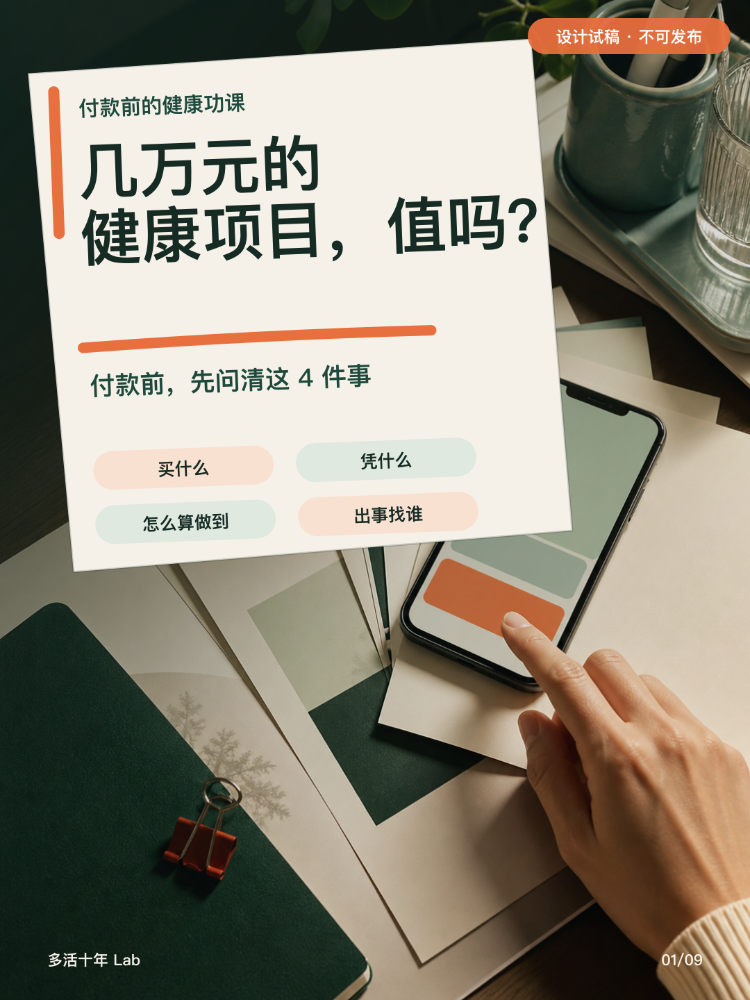
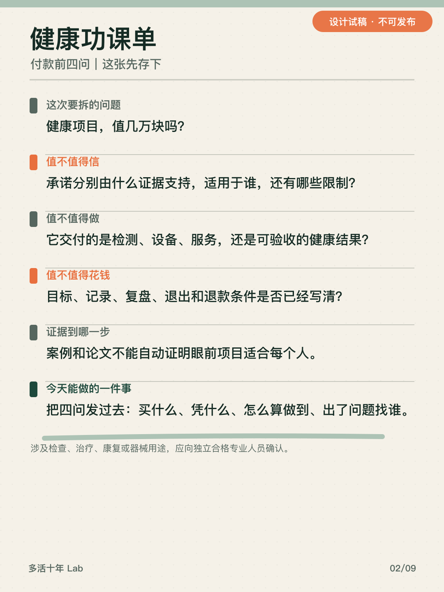
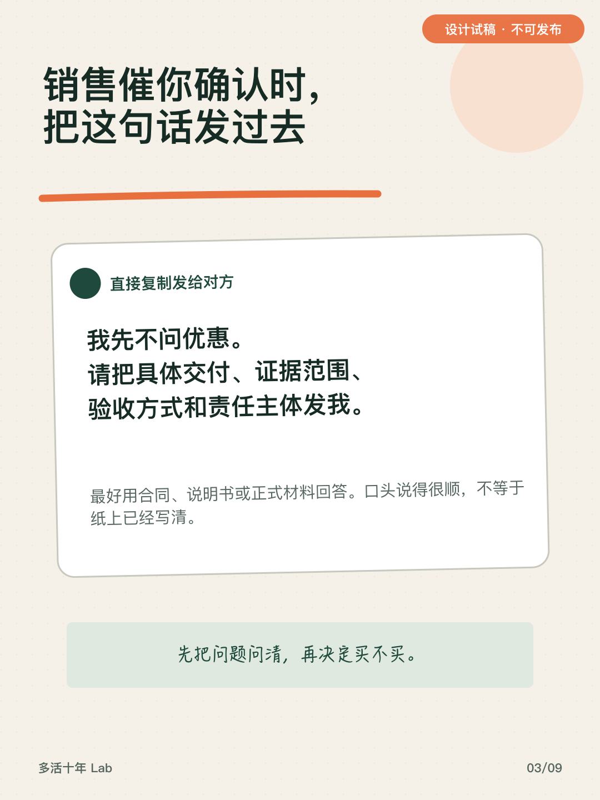
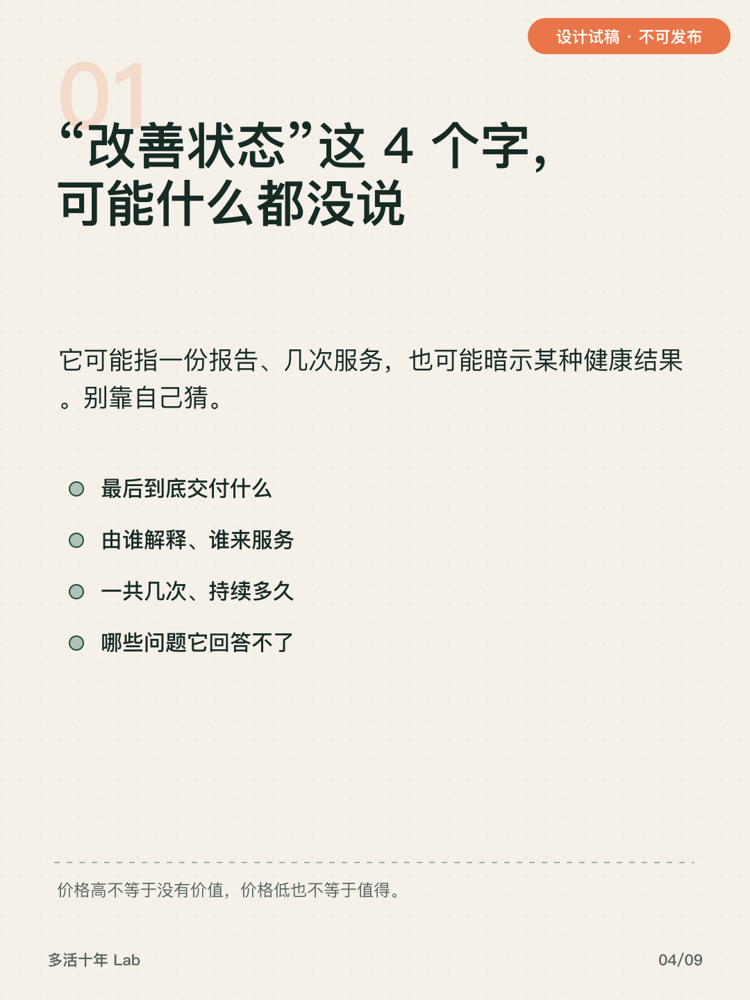
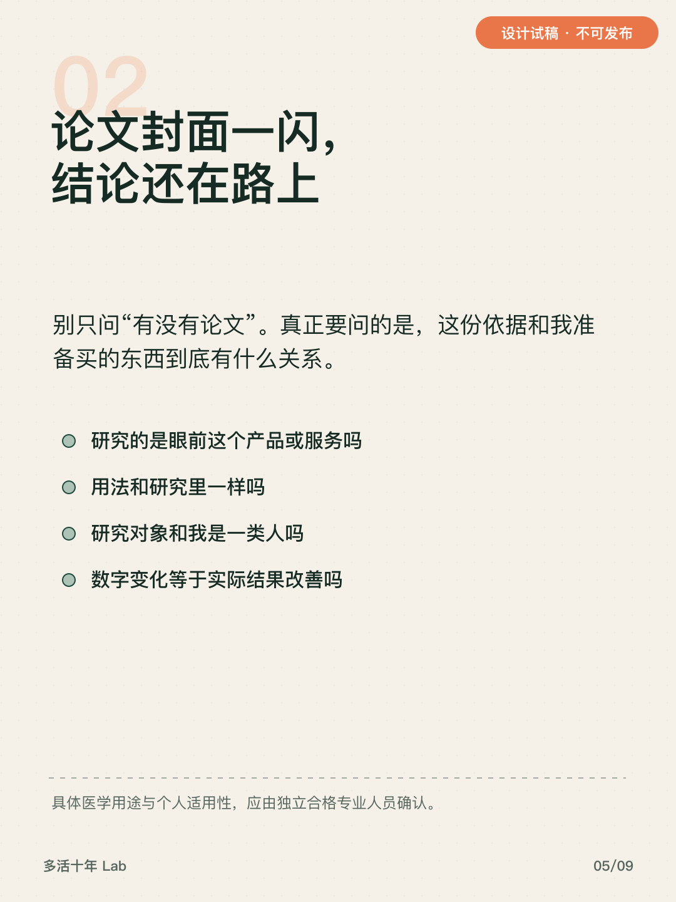
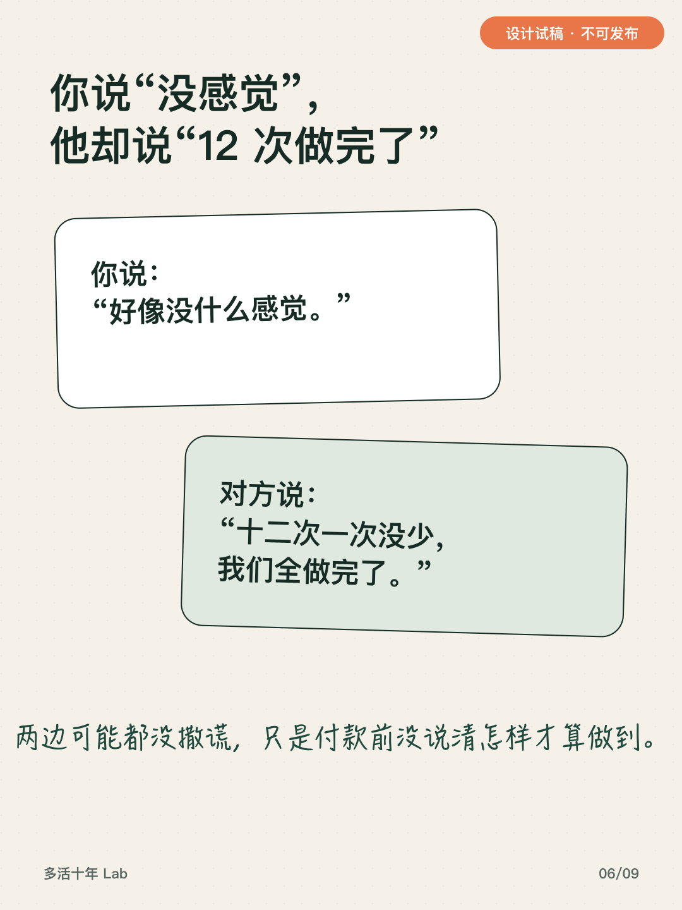
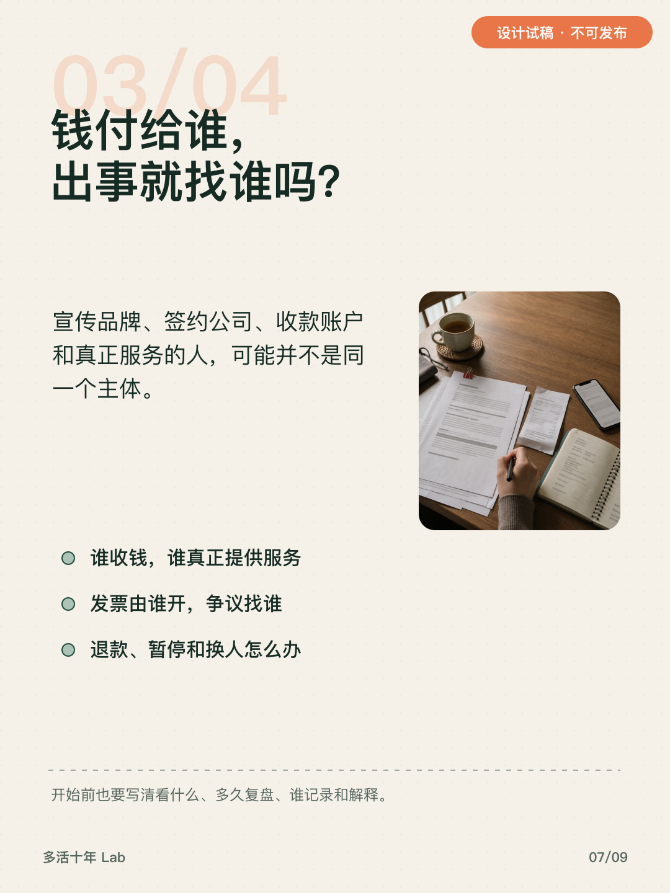
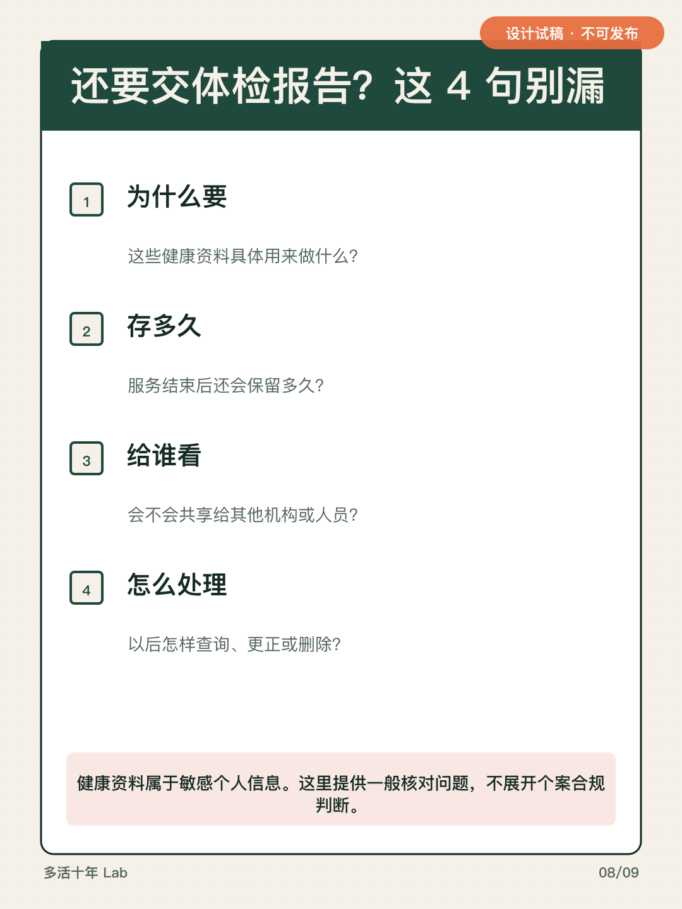
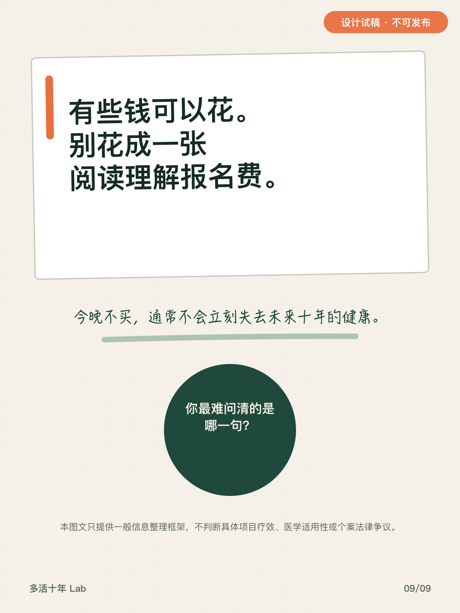

# 小红书发帖 Brief

> 内容状态：`DesignTrial / NotReleaseReady`  
> 使用状态：**审核用发帖包，当前不可发布**

## 1. 文字标题

准备花几万元买健康项目？付款前先问这4件事

## 2. 正文内容

晚上十点，销售还在等你确认。优惠、名额、案例一起往前推，人很容易先问：还能不能便宜一点？

这时候更该先问的是：这几万元，我到底买到了什么？

我把付款前需要核对的信息整理成了四句：

1. 买什么：具体交付什么，谁来做，哪些问题回答不了？
2. 凭什么：依据真正支持什么，和眼前这个项目有什么关系？
3. 怎么算做到：开始前看什么，多久复盘，由谁记录和解释？
4. 出事找谁：谁收钱、谁服务、发票谁开，退款或暂停怎么办？

如果还要提交体检报告、病历或影像，再问清用途、保存时间、共享对象，以及怎样查询、更正或删除。

这四句不能替你判断具体项目有没有疗效，也不能判断它是否适合个人。涉及检查、治疗、康复或医疗器械用途，应找独立、具备相应资质的专业人员确认。

今晚不急着付。请对方用合同、说明书或正式材料回答。说清楚不等于一定该买，一项答不上来也不等于当场违法。

有些钱可以花。别花成一张阅读理解报名费。

## 3. 互动收口

这四句里，你最难问清的是哪一句？

## 4. 标签

#健康消费 #理性消费 #健康管理 #消费者权益 #个人信息保护

## 5. 图片上传顺序

1. `images/01-cover.png`
2. `images/02-homework-sheet.png`
3. `images/03-send-this.png`
4. `images/04-promise.png`
5. `images/05-evidence.png`
6. `images/06-acceptance-mismatch.png`
7. `images/07-responsibility.png`
8. `images/08-health-data.png`
9. `images/09-closing.png`

## 6. 发布设置与检查

- 按编号 `01` 至 `09` 上传，不调整顺序；
- AI／合成内容说明：封面及责任场景底图由 AI 生成；所有中文、清单与限制由确定性排版完成。
- 发布时根据平台当日功能完成 AI 内容标识；
- 标题长度、图片数量和其他输入限制以发布页当日提示为准；
- 当前状态不是 `ReleaseReady` 时，不得移除试稿标识或上传发布；
- 发布前由创作者完成最终标题、正文、图片、标签和账号状态检查。

## 7. 图片预览

### 第 1 张

### 第 2 张

### 第 3 张

### 第 4 张

### 第 5 张

### 第 6 张

### 第 7 张

### 第 8 张

### 第 9 张

